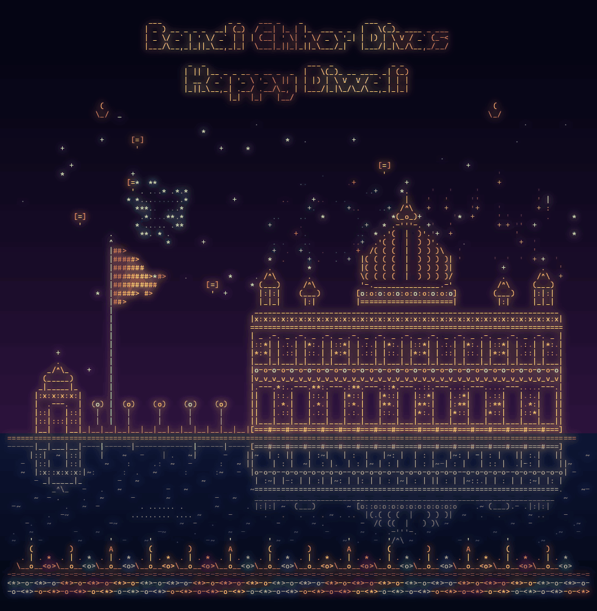

# Bandi Chhor Diwali ASCII



A Python script that generates an animated Diwali greeting featuring a stylized Golden Temple scene, fireworks, lanterns, and glowing diyas in ASCII-art-inspired rendering.

This project celebrates Bandi Chhor Divas and Diwali with a festive skyline scene built using Python, Pillow, and pyfiglet.

## Features

- Animated ASCII-style temple and skyline composition
- Fireworks, lanterns, water reflections, and diya lighting
- Bright celebratory color palette rendered into a GIF output
- Custom title banner: "Bandi Chhor Divas" and "Happy Diwali"
- Output files including the final GIF and preview PNG frames

## Requirements

- Python 3.8+
- Pillow
- pyfiglet

Install dependencies:

```bash
pip install pillow pyfiglet
```

## Run

From the project directory:

```bash
python make_gif_v3.py
```

This will generate:

- `output/bandi_chhor_diwali_hd.gif`
- `output/hd12.png`
- `output/hd33.png`

## Notes

The script currently points to a DejaVu monospace font path used on Linux systems:

```python
/usr/share/fonts/truetype/dejavu/DejaVuSansMono.ttf
```

If you are running this on Windows or a different Linux distribution, update the font paths in `make_gif_v3.py` to a valid installed DejaVu Sans Mono font location.

## Project Purpose

This project is a creative celebration artwork: it combines geometric ASCII temple building, celebratory motifs, and animated frame generation to produce a festive Diwali greeting.

## License

This project is provided as-is for personal and festive use. If you plan to reuse or adapt it, please credit the original project and keep the celebratory intent intact.
